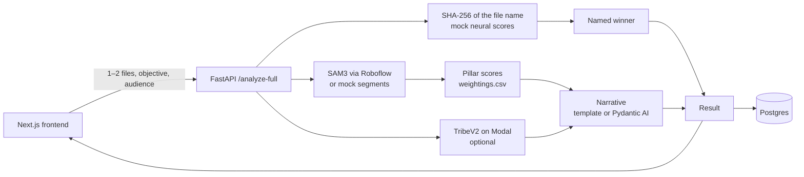

# ArcAnalytics

Before you pay to run an advert, ArcAnalytics scores the visual parts of one or two uploaded creatives, and a predicted brain response when TribeV2 is configured.

Built at the [Unicorn Mafia to the Americas hackathon](HACKATHON.md), shortlisted.

The GitHub repository is [`neural-ad-creative-analyzer`](https://github.com/molyleelatham/neural-ad-creative-analyzer). The older names `arcanalytics` and `adlens` still resolve to it. The deployed services keep the ArcAnalytics name.

## What it does

You upload one or two ad creatives, pick a campaign objective (purchase, engagement, virality or clarity) and an audience, and get a comparison back.

- Segmentation labels the visual parts the model finds, such as a logo, product, face, text or call to action. If Roboflow is not configured, the API uses a fixed set of mock segments.
- Those parts are scored against `backend/weightings.csv` for the pillars in that sheet.
- When `TRIBEV2_URL` is set and the service answers, TribeV2 on Modal adds brain-response scores, including a comparison of two ads and, for a single ad, a comparison against the baseline that service returns.
- You also get a short written summary. That text is a template unless an OpenAI or Gemini key is set, in which case Pydantic AI writes it.
- A successful `/analyze-full` is stored in Postgres. The history pages do not reliably read that store back. See [Known gaps](#known-gaps).

## How it works



`/analyze-full` starts the visual pipeline and the TribeV2 calls together. If TribeV2 is not configured or does not answer, the visual result still comes back, with a warning. For a video, frames are extracted before segmentation.

The winner named on the result is chosen from the mock neural scores, not from the pillar scores and not from TribeV2.

## How the pieces fit

- **Segmentation** (`backend/agents/sam3_agent.py`). When `ROBOFLOW_API_KEY`, `ROBOFLOW_WORKSPACE` and `ROBOFLOW_WORKFLOW_ID` are set, this calls the Roboflow workflow (the blueprint uses workspace `arcanalytics` and workflow `sam3`). Video files are split into frames first (eight by default, overridable with `SAM3_VIDEO_MAX_FRAMES`). Raw classes are mapped through `backend/class_remap.csv`. A segment's percentage is its area divided by the total detected area, from the polygon when there is one and from a bounding box otherwise. If Roboflow is missing or the call fails, `backend/agents/segmentation_agent.py` supplies four fixed mock segments.
- **Pillar scoring** (`backend/services/compare_service.py`). A segment's strength is `100 × (0.7 × confidence + 0.3 × min(area share / 20%, 1))`. Strengths are combined per pillar with the weights in `backend/weightings.csv`, and the positive weights in a pillar are normalised so they sum to 1. A negative weight is a penalty, so something like clutter lowers a score instead of being ignored.
- **Mock neural scores** (`backend/agents/neural_agent.py`, `backend/agents/attribution_agent.py`). Both `/compare` and the visual half of `/analyze-full` build purchase, engagement, virality and clarity scores from a SHA-256 of the file name. They do not depend on the image. The named winner is the higher of those scores for the objective you picked.
- **Brain response** (`backend/services/tribev2_client.py`). This calls a TribeV2 app on Modal (`TRIBEV2_URL`), with a 120-second default timeout. It can score one ad, compare two, and pass through a baseline comparison when TribeV2 returns one. Failures are logged and skipped. The Modal app itself is not in this repository. See the submodule note in [Known gaps](#known-gaps).
- **Narrative** (`backend/agents/pydantic_ai_narrative.py`). With `OPENAI_API_KEY` or `GOOGLE_API_KEY`, Pydantic AI writes the summary. `PYDANTIC_AI_MODEL` overrides the model. With only a Google key the default is `google-gla:gemini-2.5-flash`. If an OpenAI key is set, the default is `openai:gpt-4o-mini`. Otherwise the API keeps the template text.
- **Storage** (`database/schema.sql`, `backend/database.py`). Twelve tables: `organizations`, `users`, `campaigns`, `analyses`, `variants`, `visual_scores`, `visual_segments`, `brain_analysis`, `comparisons`, `industry_benchmarks`, `usage_logs` and `monthly_usage`. `/analyze-full` writes the analysis, its variants, visual scores, segments and brain row when Postgres is up. The insert uses a fixed organisation id, which `backend/migrate.py` creates.

`/compare` is the older route. It accepts up to five files, runs the same visual and mock-score path, and does not call TribeV2.

## Finding your way around

```text
backend/
  main.py              FastAPI app
  migrate.py           creates the Postgres schema
  agents/              SAM3, narrative, and the mock neural and attribution agents
  services/            pillar scoring, TribeV2 client, /analyze-full orchestration
  storage/             upload directory
  models/              Pydantic request and response models
  class_remap.csv      raw segment class to the taxonomy
  weightings.csv       pillar weights
database/schema.sql    Postgres schema
frontend/app/          Next.js pages: landing, /analyze, /dashboard
frontend/components/   brain visualisation and shared UI
arcanalytics/          submodule gitlink, private, not checked out here
render.yaml            Render blueprint
runtime.txt            python-3.12.0
```

## Known gaps

- **No test suite.** `test_db_connection.py` is a manual connectivity script.
- **No accuracy figure.** There is no evaluation code and no labelled set in this repository. Nothing here supports a percentage accuracy.
- **The headline scores are mock values.** In `/compare`, and on the visual object returned by `/analyze-full`, purchase, engagement, virality and clarity come from a SHA-256 of the file name. Real brain-response data is only what TribeV2 returns, and only on `/analyze-full`.
- **The Bayesian chart on the analyse page is drawn in the browser.** `frontend/app/analyze/page.tsx` computes that curve from the pillar timeline. It is not a fitted model. When TribeV2 responds, it can include its own `posterior_P_convert` series, and `BrainViz` will plot that series. This repository does not recompute it.
- **History is only partly wired.** `GET /analyses`, `GET /analyses/{id}` and `GET /stats` call `get_analyses`, `get_analysis_by_id` and `get_usage_stats` on `DatabaseManager`. Those methods are not defined, so the routes come back empty or with an error object. `GET /retrieve-analyses` returns two hardcoded examples, including a lift figure that was not measured. `POST /export-analysis` does not write a row: it builds an `AnalysisCreate` without the organisation id that model requires, and the error path refers to `HTTPException`, which is not imported in that function.
- **A failed save does not fail `/analyze-full`.** The handler waits for the insert, catches the error, adds a warning, and still returns the analysis.
- **Three flags in `backend/config.py` are unused.** `USE_ROBOFLOW`, `USE_LLM` and `USE_MOCKS` are never read. Roboflow runs when the three Roboflow variables above are set. The language model runs when an API key is set.
- **`.env.example` lists Supabase URL and keys.** The Python app does not read them. It uses `DATABASE_URL` with asyncpg.
- **The landing page promises more than the code measures.** Copy on `frontend/app/page.tsx` talks about projected conversion lift and category benchmarks. This repository does not compute lift. Any baseline numbers are whatever TribeV2 puts in its response. The narrative prompt in `backend/agents/pydantic_ai_narrative.py` also includes an example sentence with a visual weight and an activation value. Those figures are not measurements.
- **`AGENTS.md` describes a wider system than this tree.** It mentions Bayesian A/B services, PyMC and endpoints that are not implemented here. This README is the accurate guide.
- **The `arcanalytics` path is a submodule gitlink** (commit `72399081ed3f1040c4d996cefb2864a4c46f5b8e`) and there is no `.gitmodules` file. It points at the private repository `molyleelatham/arcanalytic`, which holds the TribeV2 Modal service. A normal clone does not fetch it. Brain scoring needs a TribeV2 URL that is already deployed. The gitlink is left as it is.

## Stack

- **Backend:** Python 3.12 (`runtime.txt` and `render.yaml` pin 3.12.0), FastAPI, Pydantic, Pydantic AI, Roboflow, TribeV2 on Modal, PostgreSQL 16.
- **Frontend:** Next.js 16.2.4, React 19.2.4, TypeScript, Tailwind CSS 4. The frontend service pins Node 20.11.0.
- **Hosting:** Render, Oregon region.

## Running it

```bash
git clone https://github.com/molyleelatham/neural-ad-creative-analyzer.git
cd neural-ad-creative-analyzer

python3.12 -m venv .venv && source .venv/bin/activate
pip install -r backend/requirements.txt

# Roboflow, only if you want real segments. There is no USE_ROBOFLOW switch.
export ROBOFLOW_API_KEY=...
export ROBOFLOW_WORKSPACE=arcanalytics
export ROBOFLOW_WORKFLOW_ID=sam3

export TRIBEV2_URL=...          # optional; without it, brain scoring is skipped
export DATABASE_URL=postgresql://...   # optional; without it, nothing is stored
export OPENAI_API_KEY=...       # optional narrative, either key is enough
export GOOGLE_API_KEY=...

python backend/migrate.py migrate    # needs DATABASE_URL
uvicorn backend.main:app --reload --host 0.0.0.0 --port 8000
```

In another terminal:

```bash
cd frontend && npm install && npm run dev
```

The frontend is at `http://localhost:3000` and the API docs at `http://localhost:8000/docs`. Health checks on the API are `GET /health`, `GET /tribev2/health` and `GET /roboflow/health`.

Without the Roboflow variables you get mock segments. Without the private Modal app, or a `TRIBEV2_URL` that already points at one, you get no brain scores. The API still answers.

## Deployment

`render.yaml` describes three resources, all in Oregon. These names are the deployed identities and should stay as they are.

| Resource | Name |
|---|---|
| Backend web service | `arcanalytics-backend` (`uvicorn backend.main:app`) |
| Frontend web service | `arcanalytics-frontend` (Next.js, `rootDir: frontend`) |
| Database | `arcanalytics-db` (PostgreSQL 16, database `arcanalytics`, user `arcanalytics_user`, starter plan) |

The backend build installs `backend/requirements.txt` and runs `python backend/migrate.py migrate`. That script applies `database/schema.sql` and inserts the default organisation row the save path expects. It is safe to run on every deploy: existing tables are left in place.

The blueprint sets `ROBOFLOW_WORKSPACE=arcanalytics`, `ROBOFLOW_WORKFLOW_ID=sam3` and `TRIBEV2_TIMEOUT=120`. Keys (`ROBOFLOW_API_KEY`, `TRIBEV2_URL`, `GOOGLE_API_KEY`, `LOGFIRE_TOKEN`, `CORS_ORIGINS`) are filled in on the Render service. `OPENAI_API_KEY` is not in the blueprint. Add it there if you want the OpenAI narrative in production.

`frontend/next.config.js` proxies `/api/*` to `NEXT_PUBLIC_BACKEND_URL`, and in production falls back to `https://arcanalytics-3np8.onrender.com` when that variable is unset.
